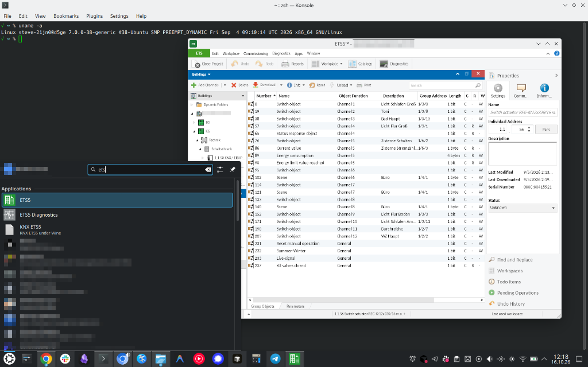

# ETS5 on Linux



Run KNX ETS 5.7 under Wine, with the license stick either plugged into this
machine or forwarded from another Linux host over USB/IP ([RUDY](https://github.com/ckware/rudy)).

This repository installs nothing from KNX. You bring `Ets5Setup.exe` and the
physical license stick. The scripts download only the Microsoft .NET
redistributables they need, and they check those downloads.

Tested on Ubuntu 26.04 with Wine 11.19 and ETS 5.7.7 (file version
5.7.1428.39779). Wine must be at least 11.10. Older Wine cannot walk from
the HID interface to the USB parent device, so ETS never sees the stick
([WineHQ bug 59604](https://bugs.winehq.org/show_bug.cgi?id=59604)).

## Workstation

```sh
sudo apt-get install -y make
make host          # Wine, fonts, vhci-hcd, udev
make prefix        # ~/.local/share/wineprefixes/ets5
make dotnet        # .NET Framework 4.8
make mscoree       # native mscoree and COM registration
make fonts
make ets ETS_SETUP=/path/to/Ets5Setup.exe
make verify
make desktop       # optional application-menu entry
make launch
```

`make launch` starts ETS in its own session. Closing the terminal must not
close ETS. The window is up for real when the status bar names the license
tier that belongs to the stick, for example `ETS5 Lite`. `lsusb` showing
`2a07:0102` is only the transport.

Log out and back in once after `make host` if it added your user to `plugdev`.

## Dongle on another machine

On the machine the stick is plugged into:

```sh
cp .env.example .env
# set USBIP_BIND_ADDRESS to that machine's LAN address, not 0.0.0.0
make host-server
make server-up
```

On the workstation, set `USBIP_SERVER` in `.env` to that machine and run
`make client-up`. Load `usbip-host` before the first server start. The
script does this. Do not run a native `usbip attach` at the same time as
`rudy-client`.

`make server-down` and `make client-down` stop only this compose project.

MQTT is optional. Set `MQTT_OPTIONS` in each machine's own `.env` (different
broker users). Empty means USB/IP without self-heal: after a server restart
you then run `docker exec rudy-client reload` yourself.

## What success looks like

`make verify` checks Wine, the prefix, .NET 4.8, native `mscoree`, and a
32-bit CLR program. After ETS is installed:

```sh
make verify-cctor
```

prints `cctor OK`. Then `make launch`. The status bar is the license check.
A `.license` file, if you have one, is imported from the ETS UI. Do not
commit it.

## Layout

| Path | Role |
|---|---|
| `scripts/00-host.sh` | Packages, WineHQ repo, kernel module, udev |
| `scripts/10-prefix.sh` | win64 prefix |
| `scripts/20-dotnet.sh` | .NET 4.8 |
| `scripts/30-mscoree.sh` | Microsoft `mscoree.dll` and COM keys |
| `scripts/40-fonts.sh` | WPF font fallback |
| `scripts/50-ets.sh` | ETS installer |
| `scripts/60-verify.sh` | Checkpoints |
| `bin/ets5` | Detached launcher |
| `compose/client` | `rudy-client` |
| `compose/server` | `rudy-server` |
| `probe/hidparent-probe.c` | HID parent-chain probe |

`AGENTS.md` is the runbook for repeating this unattended, including the
failures that look like success.

## Removing it

```sh
make client-down          # workstation
make server-down          # dongle host
rm -rf ~/.local/share/wineprefixes/ets5
sudo rm -f /etc/udev/rules.d/70-knx-ets-dongle.rules
```

That does not remove Wine, and it does not stop any other Docker project.
